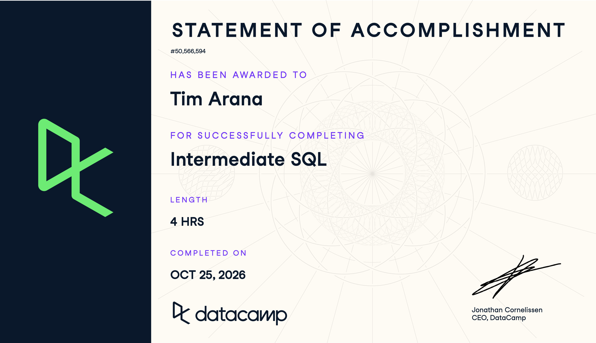

## Introduction

This report documents my completion of DataCamp's Intermediate SQL course on October 25, 2026, as part of IBM 6500.

The course expanded my SQL knowledge through data aggregation, filtering, transformation, sorting, and grouping. These skills will help me analyze marketing data using SQL and BigQuery and support future research for my MSDM Culminating Experience Project (CEP).

## Course-Completion Evidence

I completed DataCamp's Intermediate SQL course on October 25, 2026.



## Chapter 1: Data Aggregation

### Main Ideas

In this chapter, I learned how to count records, identify unique values, and write SQL queries more effectively. I also learned that SQL executes commands in a different order than how they are written.

These concepts are useful when exploring a new dataset and understanding what information is available before performing more detailed analysis.

### Important SQL Syntax

-   `COUNT(*)`: Counts all records in a table.
-   `COUNT(column)`: Counts non-NULL values in a column.
-   `DISTINCT`: Removes duplicate values.
-   `COUNT(DISTINCT column)`: Counts unique non-NULL values.
-   `AS`: Assigns a descriptive name to a result.
-   `LIMIT`: Restricts the number of records returned.

### SQL Example 1: Counting Records

``` sql
SELECT COUNT(*) AS total_films
FROM films;
```

**Explanation:**

This query counts the total number of records in the films table. The result appears in a column named `total_films`.

I would use this query when checking the size of a dataset before beginning an analysis.

### SQL Example 2: Counting Unique Values

``` sql
SELECT COUNT(DISTINCT country) AS unique_countries
FROM films;
```

**Explanation:**

This query counts the number of different countries represented in the films dataset.

Using `DISTINCT` prevents repeated country names from being counted multiple times.

### Query Execution and SQL Formatting

I learned that SQL does not execute commands in the same order they are written.

For a basic query, SQL processes:

1.  `FROM`: Identifies the data source.
2.  `SELECT`: Determines which columns to return.
3.  `LIMIT`: Restricts the final number of records.

I also practiced debugging errors and following SQL formatting conventions.

Some important practices include capitalizing SQL keywords, placing major clauses on separate lines, using descriptive aliases, and ending queries with semicolons.

### CEP Application

For my MSDM Culminating Experience Project, these techniques could help me explore Salesforce data before conducting more advanced analysis.

For example:

``` sql
SELECT
    COUNT(*) AS total_opportunities,
    COUNT(DISTINCT acct_alias) AS unique_accounts
FROM sales_data;
```

This query would show the total number of opportunity records and the number of unique account aliases.

It could help me understand the size and composition of the dataset before analyzing sales performance or customer behavior.

### Key Takeaway

My biggest takeaway from this chapter was understanding the difference between counting all records and counting unique values.

I also learned that organizing SQL queries clearly makes them easier to debug, understand, and reuse.

## Chapter 2: Data Filtering

### Main Ideas

In this chapter, I learned how to filter records using different SQL conditions. Instead of retrieving every record from a table, I can use the `WHERE` clause to focus on specific information.

I also learned how to combine conditions, search for text patterns, select values within ranges, and identify missing information.

These techniques are useful when analyzing large datasets because they allow me to narrow my results to the records relevant to a particular research question.

### Important SQL Syntax

-   `WHERE`: Filters records based on specified conditions.
-   `AND`: Requires multiple conditions to be true.
-   `OR`: Includes records that satisfy at least one condition.
-   `BETWEEN`: Filters values within an inclusive range.
-   `IN`: Matches values against a specified list.
-   `LIKE`: Searches for text patterns.
-   `NOT LIKE`: Excludes records matching a text pattern.
-   `%`: Matches zero or more characters in a text pattern.
-   `_`: Matches exactly one character.
-   `IS NULL`: Identifies missing values.
-   `IS NOT NULL`: Identifies values that are present.

### SQL Example 1: Filtering with WHERE and AND

``` sql
SELECT title, release_year, language
FROM films
WHERE release_year > 2000
AND language = 'English';
```

**Explanation:**

This query retrieves films released after 2000 that are in English.

Both conditions must be satisfied because the query uses `AND`.

I would use this technique when analyzing records that must meet multiple requirements.

### SQL Example 2: Using BETWEEN and IN

``` sql
SELECT title, release_year, language
FROM films
WHERE release_year BETWEEN 1990 AND 2000
AND language IN ('English', 'Spanish', 'French');
```

**Explanation:**

This query retrieves films released between 1990 and 2000, including both years.

The `IN` operator limits the results to films in English, Spanish, or French.

Using `IN` is more efficient to write than repeating multiple `OR` conditions.

### SQL Example 3: Searching Text with LIKE

``` sql
SELECT name
FROM people
WHERE name LIKE 'B%';
```

**Explanation:**

This query returns names beginning with the letter B.

The `%` wildcard allows any number of characters to appear after B.

I learned that `LIKE` is useful when searching for patterns rather than exact values.

To exclude names beginning with B, I could use:

``` sql
SELECT name
FROM people
WHERE name NOT LIKE 'B%';
```

### SQL Example 4: Identifying Missing Values

``` sql
SELECT title
FROM films
WHERE budget IS NULL;
```

**Explanation:**

This query identifies films that do not have recorded budget information.

I learned that `NULL` represents missing or unknown information and is different from zero.

To find films with available budget information, I could use:

``` sql
SELECT title, budget
FROM films
WHERE budget IS NOT NULL;
```

### Combining Multiple Filtering Conditions

One of the more challenging concepts was combining several conditions in the same query.

For example:

``` sql
SELECT title, release_year, language
FROM films
WHERE release_year BETWEEN 1990 AND 1999
AND language = 'English'
AND certification IN ('G', 'PG', 'PG-13');
```

**Explanation:**

This query identifies English-language films released during the 1990s with G, PG, or PG-13 certifications.

I learned that combining `BETWEEN`, `AND`, and `IN` allows me to answer more specific analytical questions.

Parentheses are also important when combining `AND` and `OR` because they help control how conditions are evaluated.

### CEP Application

For my MSDM Culminating Experience Project, filtering will be useful when analyzing Salesforce opportunities and identifying specific customer or sales segments.

For example:

``` sql
SELECT
    opp_id,
    insurance_main,
    sales
FROM sales_data
WHERE insurance_main IN ('Medicare', 'Private')
AND sales > 10000;
```

This example would retrieve opportunities associated with the specified insurance categories and sales amounts greater than \$10,000, assuming those categories are present in the dataset.

I could also use `IS NULL` to identify incomplete Salesforce records before conducting further analysis.

Filtering would help me focus on relevant opportunities, compare customer segments, and improve data quality.

### Key Takeaway

My biggest takeaway from this chapter was learning how to combine different filtering conditions to answer specific questions.

I found that `WHERE`, `AND`, `IN`, and `BETWEEN` were especially useful because they made complex filtering easier to organize.

Understanding `NULL` was also important because missing values can affect the accuracy of an analysis.

## Chapter 3: Data Transformation

### Main Ideas

In this chapter, I learned how to use SQL functions and arithmetic operations to transform raw data into useful information.

I practiced calculating totals, averages, minimum and maximum values, rounding numerical results, and creating calculated columns.

These techniques are useful in marketing analytics because they allow me to summarize performance metrics and calculate new measurements from existing data.

### Important SQL Syntax

-   `SUM()`: Calculates the total of numerical values.
-   `AVG()`: Calculates the average of numerical values.
-   `MIN()`: Finds the smallest value.
-   `MAX()`: Finds the largest value.
-   `COUNT()`: Counts records or non-NULL values.
-   `ROUND()`: Rounds numerical values to a specified number of decimal places.
-   `+`, `-`, `*`, `/`: Perform arithmetic calculations.
-   `AS`: Assigns descriptive names to calculated columns.
-   `WHERE`: Filters records before aggregate calculations.

### SQL Example 1: Using Aggregate Functions

``` sql
SELECT
    SUM(duration) AS total_duration,
    AVG(duration) AS average_duration,
    MIN(duration) AS shortest_film,
    MAX(duration) AS longest_film
FROM films;
```

**Explanation:**

This query calculates four statistics from the films dataset.

`SUM()` calculates the total duration of all films, while `AVG()` calculates the average duration.

`MIN()` identifies the shortest recorded duration, and `MAX()` identifies the longest.

I would use these functions when I need a quick summary of numerical data.

### SQL Example 2: Combining Aggregates with WHERE

``` sql
SELECT SUM(gross) AS total_gross
FROM films
WHERE release_year >= 2000;
```

**Explanation:**

This query calculates the total gross revenue of films released in 2000 or later.

The `WHERE` clause filters the records before `SUM()` calculates the total.

I learned that combining aggregate functions with filtering allows me to calculate statistics for specific groups of records.

### SQL Example 3: Using ROUND()

``` sql
SELECT ROUND(AVG(budget), -3) AS avg_budget_thousands
FROM films;
```

**Explanation:**

This query calculates the average film budget and rounds the result to the nearest thousand.

The negative parameter `-3` tells SQL to round three positions to the left of the decimal point.

I also learned that positive parameters can be used to round decimal values.

For example:

``` sql
SELECT ROUND(AVG(facebook_likes), 1) AS avg_facebook_likes
FROM reviews;
```

This calculates the average number of Facebook likes and rounds the result to one decimal place.

### SQL Example 4: Arithmetic and Calculated Columns

``` sql
SELECT
    title,
    ROUND(duration / 60.0, 2) AS duration_hours
FROM films;
```

**Explanation:**

This query converts film durations from minutes into hours.

Dividing by `60.0` preserves decimal values, while `ROUND(..., 2)` rounds the results to two decimal places.

For example, a film lasting 125 minutes would have a calculated duration of approximately 2.08 hours.

I learned that SQL can create new calculated columns without changing the original data.

### SQL Example 5: Calculating Percentages

``` sql
SELECT
    COUNT(deathdate) * 100.0 / COUNT(*) AS percentage_dead
FROM people;
```

**Explanation:**

This query calculates the percentage of people in the dataset with a recorded death date.

`COUNT(deathdate)` counts non-NULL death dates, while `COUNT(*)` counts all records.

Multiplying by `100.0` converts the proportion into a percentage while preserving decimal values.

This technique is especially useful when calculating marketing performance metrics.

### CEP Application

For my MSDM Culminating Experience Project, aggregate functions and arithmetic calculations could help me evaluate Salesforce sales performance.

For example:

``` sql
SELECT
    COUNT(*) AS total_opportunities,
    SUM(sales) AS total_sales,
    ROUND(AVG(sales), 2) AS average_sales,
    MAX(sales) AS highest_sale,
    MIN(sales) AS lowest_sale
FROM sales_data;
```

This example would summarize the number of opportunities, total recorded sales, average sales, highest sale, and lowest sale.

These calculations could help identify overall sales performance and provide a foundation for comparing customer segments.

I could also calculate conversion rates, revenue per unit, and other business metrics using arithmetic operations.

### Key Takeaway

My biggest takeaway from this chapter was learning how SQL can transform raw numerical values into meaningful business metrics.

I found `AVG()`, `SUM()`, and `ROUND()` especially useful because they are commonly used in marketing and financial analysis.

One challenging concept was understanding how integer division affects calculations. I learned to use decimal values when necessary to preserve precision.

These techniques will help me create more accurate and readable analytical reports in BigQuery.

## Chapter 4: Sorting and Grouping

### Main Ideas

In this chapter, I learned how to organize SQL query results, group records into categories, and filter groups based on calculated statistics.

I practiced sorting data using `ORDER BY`, summarizing records with `GROUP BY`, and filtering aggregated results using `HAVING`.

These techniques are useful for business analytics because they allow me to compare performance across different categories and identify trends in large datasets.

### Important SQL Syntax

-   `ORDER BY`: Sorts query results based on one or more columns.
-   `ASC`: Sorts values in ascending order.
-   `DESC`: Sorts values in descending order.
-   `GROUP BY`: Groups records that share common values.
-   `HAVING`: Filters groups based on aggregate calculations.
-   `COUNT(DISTINCT column)`: Counts unique values within a group.
-   `LIMIT`: Restricts the number of results returned.

### SQL Example 1: Sorting Records

``` sql
SELECT title, duration
FROM films
ORDER BY duration DESC;
```

**Explanation:**

This query retrieves film titles and durations, sorting them from longest to shortest.

The `DESC` keyword specifies descending order.

I would use this technique when ranking records by numerical values, such as revenue, customer spending, or campaign performance.

### SQL Example 2: Sorting Multiple Fields

``` sql
SELECT certification, release_year, title
FROM films
ORDER BY certification ASC, release_year DESC;
```

**Explanation:**

This query first sorts films alphabetically by certification.

Within each certification category, films are sorted from newest to oldest.

I learned that SQL prioritizes the first sorting column before applying the second.

### SQL Example 3: Grouping Records

``` sql
SELECT
    release_year,
    COUNT(*) AS film_count,
    AVG(duration) AS avg_duration
FROM films
GROUP BY release_year;
```

**Explanation:**

This query groups films by release year.

For each year, it calculates the number of films and their average duration.

Unlike `ORDER BY`, which only changes the order of records, `GROUP BY` allows aggregate calculations for each category.

### SQL Example 4: Grouping Multiple Fields

``` sql
SELECT
    release_year,
    country,
    MAX(budget) AS max_budget
FROM films
GROUP BY release_year, country
ORDER BY release_year, country;
```

**Explanation:**

This query calculates the highest film budget for each combination of release year and country.

Grouping by multiple columns allows me to compare results across more specific categories.

For example, films released in the United States in 2000 form a different group from films released in France during the same year.

### SQL Example 5: Filtering Groups with HAVING

``` sql
SELECT
    country,
    COUNT(DISTINCT certification) AS certification_count
FROM films
GROUP BY country
HAVING COUNT(DISTINCT certification) > 10;
```

**Explanation:**

This query identifies countries with more than 10 different film certifications.

The `GROUP BY` clause organizes films by country, while `HAVING` filters the grouped results.

I learned that `WHERE` filters individual records before grouping, whereas `HAVING` filters groups after aggregate calculations.

### SQL Example 6: Combining Multiple SQL Techniques

``` sql
SELECT
    release_year,
    AVG(budget) AS avg_budget,
    AVG(gross) AS avg_gross
FROM films
WHERE release_year > 1990
GROUP BY release_year
HAVING AVG(budget) > 60000000
ORDER BY avg_gross DESC
LIMIT 1;
```

**Explanation:**

This query identifies the release year with the highest average gross revenue among years where the average film budget exceeded \$60 million.

The query follows several steps:

1.  `WHERE` filters films released after 1990.
2.  `GROUP BY` organizes films by release year.
3.  `AVG()` calculates average budget and gross revenue for each year.
4.  `HAVING` keeps only years with average budgets greater than \$60 million.
5.  `ORDER BY` ranks the remaining years by average gross revenue.
6.  `LIMIT 1` returns the highest-ranked year.

This exercise helped me understand how multiple SQL clauses work together to answer a specific analytical question.

### CEP Application

For my MSDM Culminating Experience Project, sorting and grouping could help me compare Salesforce sales performance across insurance providers and opportunity stages.

For example:

``` sql
SELECT
    insurance_main,
    COUNT(*) AS opportunity_count,
    ROUND(AVG(sales), 2) AS average_sales
FROM sales_data
WHERE sales IS NOT NULL
GROUP BY insurance_main
HAVING COUNT(*) > 100
ORDER BY average_sales DESC;
```

**Explanation:**

This example groups Salesforce opportunities by insurance provider.

It calculates the number of opportunities and average recorded sales for each insurance category.

The `HAVING` clause keeps only categories with more than 100 opportunities, while `ORDER BY` ranks them from highest to lowest average sales.

This could help identify which insurance categories are associated with higher sales performance.

The query is an illustrative example and would need to be adapted to the actual Salesforce dataset and table names.

### Key Takeaway

My biggest takeaway from this chapter was understanding the difference between sorting, grouping, and filtering aggregated results.

I found `GROUP BY` and `HAVING` especially useful because they allow me to compare business performance across categories.

The most challenging part was combining multiple SQL clauses in the correct order. Practicing the final exercises helped me understand how each clause contributes to the result.

These skills will be valuable when analyzing Salesforce opportunities, customer segments, and marketing performance in BigQuery.

## Overall Reflection and Series Synthesis

### Most Useful Concepts

The most useful concepts I learned in Intermediate SQL were filtering, aggregate functions, and grouping data. I found `WHERE`, `GROUP BY`, and `HAVING` especially valuable because they allow me to analyze specific records and summarize information across different categories.

I also learned how to combine multiple SQL clauses to answer more detailed business questions rather than simply retrieving information from a database.

### Challenges and Learning Progress

One of the more challenging concepts was understanding the difference between `WHERE` and `HAVING`. Through the DataCamp exercises, I learned that `WHERE` filters individual records before grouping, while `HAVING` filters groups based on aggregate calculations.

Another challenge was combining multiple conditions using `AND` and `OR`. Practicing with parentheses helped me understand how to control how conditions are evaluated.

I also improved my understanding of arithmetic calculations and how integer division can affect numerical results.

### Connection to Introduction to SQL

The Introduction to SQL course helped me understand basic database concepts, including selecting columns, retrieving records, and writing simple queries.

Intermediate SQL expanded on those foundations by introducing more advanced filtering, calculations, sorting, and grouping techniques.

I can now write queries that not only retrieve information but also summarize data, compare categories, and identify patterns.

### Applying SQL Skills in BigQuery

The skills I learned can be applied to Google BigQuery when analyzing large datasets.

For example, I could use `GROUP BY` to summarize sales performance across different customer segments or `HAVING` to identify categories that meet specific performance thresholds.

I could also combine aggregate functions and filtering to calculate marketing metrics such as average revenue, total sales, and conversion rates.

Although some SQL syntax differs between database systems, the fundamental concepts remain useful.

### Digital Marketing and CEP Applications

These SQL skills are relevant to digital marketing because businesses rely on data to understand customer behavior, campaign performance, and sales outcomes.

For my MSDM Culminating Experience Project, I could apply these techniques to Salesforce opportunity data to identify sales trends, compare insurance categories, and evaluate performance across different customer segments.

Filtering would help me focus on relevant records, while aggregate functions and grouping would allow me to summarize results and identify meaningful patterns.

These techniques could also support survey analysis and other marketing research activities.

### Future Reference

I expect to revisit the filtering and sorting sections of my SQL portfolio when preparing datasets for analysis.

The aggregate functions and grouping examples will also be useful when creating reports or working with larger datasets in BigQuery.

Overall, completing the three-course SQL series helped me build a stronger foundation in database analysis and gave me practical skills that I can continue developing throughout my digital marketing studies.

## Appendix: Publication Links

The following links provide access to my completed SQL learning portfolio and Intermediate SQL report.

- [GitHub Repository](https://github.com/Tarana7/ibm-6500-sql-learning-portfolio)

- [Published Intermediate SQL Report](https://tarana7.github.io/ibm-6500-sql-learning-portfolio/intermediate-sql.html)

- [Portfolio Landing Page](https://tarana7.github.io/ibm-6500-sql-learning-portfolio/index.html)